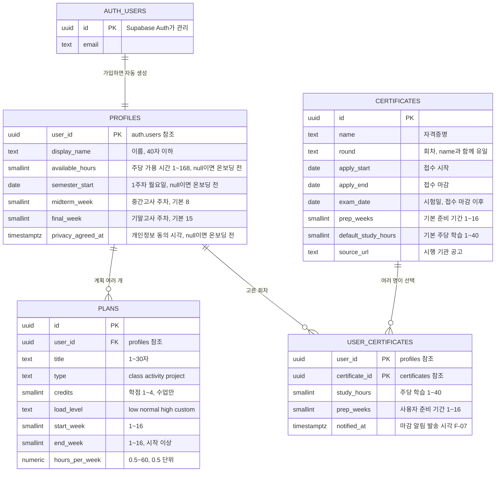
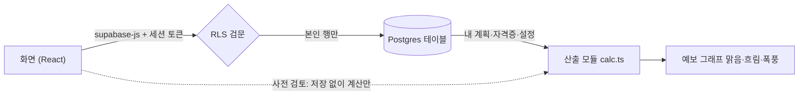

# 학기예보 구조 (ERD · 데이터 흐름 · 보안 규칙)

기준: 요구사항 명세서(2026-10-13) 4장·5장, `supabase/migrations/`

## 1. ERD — 테이블과 관계

- `certificates`는 팀이 채워 넣는 **공용 목록**이고, 나머지는 사용자마다 따로인 **개인 데이터**입니다.
- 사용자를 지우면 `auth.users → profiles → plans, user_certificates` 순서로 함께 지워집니다 (on delete cascade).

## 2. 데이터 흐름

| 흐름 | 무엇이 오가나 | 관련 |
|---|---|---|
| 가입 | Auth가 `auth.users` 생성 → 트리거가 `profiles` 생성 | FR-01-10 |
| 온보딩·설정 | `profiles` 의 가용 시간·학기 시작일·시험 주차 수정 | FR-01-11·12 |
| 계획 등록 | `plans` 추가·수정·삭제 | F-02, F-03 |
| 자격증 선택 | `certificates` 조회 → `user_certificates` 추가·삭제 | F-04 |
| 예보 | `profiles` + `plans` + `user_certificates`(+회차) 읽기 → `calc.ts`가 주차별 합산 | F-05 |
| 사전 검토 | 저장 안 한 계획을 더해 `calc.ts`로 다시 계산. **DB 호출 없음** | F-06, NFR-PERF-2 |

부담 계산은 서버가 아니라 화면 쪽 `src/features/forecast/calc.ts` 한 곳에서만 합니다(명세서 4장). 사전 검토가 저장 전 데이터로 즉시 계산해야 하기 때문입니다.
기대값은 `src/mocks/dummy-data.ts`의 `expectedForecast`(김예보 8주차 = 57h, 1.14, 폭풍)를 단위 테스트에 쓰세요.

## 3. 보안 규칙 (RLS, 명세서 5.5)

| 테이블 | 조회 | 추가 | 수정 | 삭제 |
|---|---|---|---|---|
| profiles | 본인 | 가입 트리거만 | 본인 | 계정 삭제 시 자동 |
| plans | 본인 | 본인 | 본인 | 본인 |
| certificates | 로그인 사용자 전체 | 불가 (대시보드·시드) | 불가 | 불가 |
| user_certificates | 본인 | 본인 | 본인 | 본인 |

확인 결과 (2026-10-13, 서울 프로젝트, NFR-SEC-1):

| 시도 | 결과 |
|---|---|
| 김예보가 박운영 계획 조회 | 0건 |
| 김예보가 박운영 계획 수정 | 0건 바뀜 |
| 김예보가 박운영 자격증 선택 삭제 | 0건 삭제 |
| 박운영이 김예보 계획 조회 | 0건 |
| 비로그인 자격증·계획·프로필 조회 | 0건 |

트리거 전용 함수(`handle_new_user`, `set_updated_at`)는 API로 직접 호출하지 못하게 실행 권한을 막아 두었습니다(`20261013090859_harden_functions.sql`).

## 4. 화면에서 막아야 하는 것

DB는 아래 두 가지를 막지 않습니다. 마감일이 지나면 시드가 실패하기 때문이며, 화면에서 처리합니다.

- 접수 마감된 회차 선택 불가 (FR-04-2)
- 사용자당 계획 30개 상한 (FR-02-5)

## 5. 환경

| 환경 | Supabase | 비고 |
|---|---|---|
| 로컬 개발 | 서울 프로젝트 `hxnaobwybllgdcvnwimo` (ap-northeast-2) | 데모 계정 포함 |
| 운영 | 10/19 별도 생성 예정 | 마이그레이션 + 자격증 시드만, 데모 계정 제외 |
