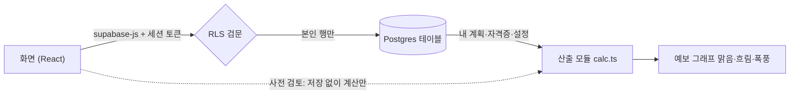

# 학기예보 구조 (ERD · 데이터 흐름 · 보안 규칙)

기준: 요구사항 명세서(2026-10-13) 4장·5장, `supabase/migrations/`

## 1. ERD — 테이블과 관계

```mermaid
erDiagram
  AUTH_USERS ||--|| PROFILES : "가입하면 자동 생성"
  PROFILES ||--o{ PLANS : "계획 여러 개"
  PROFILES ||--o{ USER_CERTIFICATES : "고른 회차"
  CERTIFICATES ||--o{ USER_CERTIFICATES : "여러 명이 선택"
  AUTH_USERS {
    uuid id PK "Supabase Auth가 관리"
    text email
  }
  PROFILES {
    uuid user_id PK "auth.users 참조"
    text display_name "이름, 40자 이하"
    smallint available_hours "주당 가용 시간 1~168, null이면 온보딩 전"
    date semester_start "1주차 월요일, null이면 온보딩 전"
    smallint midterm_week "중간고사 주차, 기본 8"
    smallint final_week "기말고사 주차, 기본 15"
    timestamptz privacy_agreed_at "개인정보 동의 시각, null이면 온보딩 전"
  }
  PLANS {
    uuid id PK
    uuid user_id FK "profiles 참조"
    text title "1~30자"
    text type "class activity project"
    smallint credits "학점 1~4, 수업만"
    text load_level "low normal high custom"
    smallint start_week "1~16"
    smallint end_week "1~16, 시작 이상"
    numeric hours_per_week "0.5~60, 0.5 단위"
  }
  CERTIFICATES {
    uuid id PK
    text name "자격증명"
    text round "회차, name과 함께 유일"
    date apply_start "접수 시작"
    date apply_end "접수 마감"
    date exam_date "시험일, 접수 마감 이후"
    smallint prep_weeks "기본 준비 기간 1~16"
    smallint default_study_hours "기본 주당 학습 1~40"
    text source_url "시행 기관 공고"
  }
  USER_CERTIFICATES {
    uuid user_id PK "profiles 참조"
    uuid certificate_id PK "certificates 참조"
    smallint study_hours "주당 학습 1~40"
    smallint prep_weeks "사용자 준비 기간 1~16"
    timestamptz notified_at "마감 알림 발송 시각 F-07"
  }
```

- `certificates`는 팀이 채워 넣는 **공용 목록**이고, 나머지는 사용자마다 따로인 **개인 데이터**입니다.
- 사용자를 지우면 `auth.users → profiles → plans, user_certificates` 순서로 함께 지워집니다 (on delete cascade).

## 2. 데이터 흐름

| 흐름 | 무엇이 오가나 | 관련 |
|---|---|---|
| 가입 | Auth가 `auth.users` 생성 → 트리거가 `profiles` 생성 | FR-01-10 |
| 온보딩·설정 | `profiles` 의 가용 시간·학기 시작일·시험 주차 수정 | FR-01-11·12 |
| 계획 등록 | `plans` 추가·수정·삭제 | F-02, F-03 |
| 자격증 선택 | `certificates` 조회 → `user_certificates` 추가·삭제 | F-04 |
| 예보 | `profiles` + `plans` + `user_certificates`(+회차) 읽기 → `calc.ts`가 주차별 합산 | F-05 |
| 사전 검토 | 저장 안 한 계획을 더해 `calc.ts`로 다시 계산. **DB 호출 없음** | F-06, NFR-PERF-2 |

부담 계산은 서버가 아니라 화면 쪽 `src/features/forecast/calc.ts` 한 곳에서만 합니다(명세서 4장). 사전 검토가 저장 전 데이터로 즉시 계산해야 하기 때문입니다.
기대값은 `src/mocks/dummy-data.ts`의 `expectedForecast`(김예보 8주차 = 57h, 1.14, 폭풍)를 단위 테스트에 쓰세요.

## 3. 보안 규칙 (RLS, 명세서 5.5)

| 테이블 | 조회 | 추가 | 수정 | 삭제 |
|---|---|---|---|---|
| profiles | 본인 | 가입 트리거만 | 본인 | 계정 삭제 시 자동 |
| plans | 본인 | 본인 | 본인 | 본인 |
| certificates | 로그인 사용자 전체 | 불가 (대시보드·시드) | 불가 | 불가 |
| user_certificates | 본인 | 본인 | 본인 | 본인 |

확인 결과 (2026-10-13 밤, 서울 프로젝트, NFR-SEC-1 — **20개 모두 통과**):

방법: DB 안에서 앱과 같은 방식(`authenticated`/`anon` 역할 + 로그인 토큰의 사용자 id)으로 김예보 로그인 상태를 만들어 박운영 데이터에 접근. 시험 후 전부 롤백하고 박운영 데이터(계획 6건·이름·자격증 선택 2건)가 그대로인 것까지 확인.

| # | 김예보로 로그인한 상태에서 시도 | 결과 |
|---|---|---|
| 1 | 박운영 계획을 **id로 직접 요청** (명세서 확인 방법) | 0건 |
| 2~5 | 박운영 계획·자격증 선택 조회 / 내 계획·프로필 조회 | 0건 / 내 계획 6건·프로필 1건만 |
| 6 | 자격증 회차 조회 (공용) | 20건 전부 |
| 7~10 | 박운영 계획·프로필 수정, 계획·자격증 선택 삭제 | 모두 0건 처리 |
| 11 | 자격증 회차 수정 | 0건 |
| 12 | 박운영 이름으로 계획 추가 | 거부 (RLS) |
| 13 | 내 계획의 주인을 박운영으로 바꾸기 | 거부 (RLS) |
| 14 | 박운영 이름으로 자격증 선택 추가 | 거부 (RLS) |
| 15 | 자격증 회차 추가 | 거부 (RLS) |
| 16 | 프로필 직접 추가 (가입 트리거만 가능) | 거부 (RLS) |
| 17~20 | **비로그인** 계획·프로필·자격증 선택·자격증 회차 조회 | 모두 0건 |

트리거 전용 함수(`handle_new_user`, `set_updated_at`, `stamp_privacy_agreed_at`)는 API로 직접 호출하지 못하게 실행 권한을 막아 두었습니다(`20261013090859_harden_functions.sql`, `20261013103836_privacy_consent.sql`).

### 비밀 키 점검 (NFR-SEC-2, 2026-10-14 — 통과)

| 검사 | 결과 |
|---|---|
| 빌드 결과물(`dist`)에 secret 키(`sb_secret_…`), service_role JWT, Google 클라이언트 보안 비밀번호(`GOCSPX-…`), AI API 키(`sk-ant-…`) | 0건. `sb_secret_` 글자는 supabase-js 가 키 종류를 구분하는 코드에만 있음 (실제 키 아님) |
| 빌드 결과물의 Supabase 키 | publishable 키 하나만 (환경변수 `VITE_SUPABASE_PUBLISHABLE_KEY`) |
| 데모 비밀번호(`hakgi1234`) | 운영 빌드에 없음 (`VITE_DEMO_LOGIN` 이 꺼진 빌드 기준) |
| GitHub 모든 브랜치·커밋 기록(46개)의 비밀 키 모양 문자열 | 0건 |
| 커밋된 `.env` 파일 | `.env.example` 만 (값 비어 있음). `.env.local` 은 `.gitignore` 로 막힘 |

### 로그인 링크 보안 (NFR-SEC-4)

- supabase-js 를 `flowType: "pkce"` 로 사용 (`src/lib/supabase.ts`). 로그인 결과 `code` 는 요청한 브라우저에서만 세션으로 바꿀 수 있어요.
- 돌아올 주소는 `window.location.origin` 기준 `/auth/callback` 이고, Supabase Redirect URLs 에 등록한 주소(로컬 `http://localhost:5173/**`, 운영 `https://ybsy.vercel.app/**`, 프리뷰 `https://*-winwater1.vercel.app/**`)로만 돌아와요.
- Google OAuth 리디렉션 URI 는 Supabase 콜백(`https://hxnaobwybllgdcvnwimo.supabase.co/auth/v1/callback`) 하나만 등록.

## 4. 화면에서 막아야 하는 것

DB는 아래 두 가지를 막지 않습니다. 마감일이 지나면 시드가 실패하기 때문이며, 화면에서 처리합니다.

- 접수 마감된 회차 선택 불가 (FR-04-2)
- 사용자당 계획 30개 상한 (FR-02-5)

## 5. 환경

| 환경 | Supabase | 비고 |
|---|---|---|
| 로컬 개발 | 서울 프로젝트 `hxnaobwybllgdcvnwimo` (ap-northeast-2) | 데모 계정 포함 |
| 운영 (ybsy.vercel.app) | 같은 서울 프로젝트 `hxnaobwybllgdcvnwimo` | 팀 결정(10/14): 운영 프로젝트를 따로 만들지 않음. 10/19에 테스트 데이터 정리 후 데모 데이터 재생성 |
